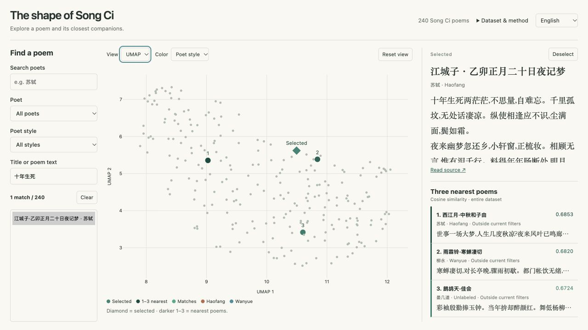

# The shape of Song Ci / 词之形



A bilingual map of 240 Song Ci poems. Explore fixed t-SNE and UMAP views,
search by poet or poem text, and read a poem alongside its three closest
companions in the original embedding space.

**[Open the app](https://song-ci-atlas.vercel.app)** ·
**[Dataset and method](docs/DATASET.md)** ·
**[Cluster findings](docs/FINDINGS.md)** ·
**[Deployment](docs/DEPLOYMENT.md)**

This folder is a self-contained Git repository nested inside the Chinese-poetry
dataset checkout. Only this app repository is published to GitHub. It does not
depend on files elsewhere in the parent checkout.

| Folder | Contents |
| --- | --- |
| `public/` | Bilingual interface, styles, and bundled Plotly renderer |
| `api/`, `lib/` | Vercel functions and Supabase client |
| `database/` | Applied schema and read-only cosine lookup functions |
| `data/` | Verified corpus, source extraction, vectors, coordinates, manifests, and reference atlas |
| `scripts/` | Crawl, corpus preparation, local embedding, projection, import, verification, and development server |
| `analysis/` | Cluster-analysis scripts and saved results |
| `docs/` | Dataset/deployment notes, findings, and English/Chinese figures |
| `tests/` | API, UI-controller, branding, and dataset integrity checks |

## Run locally

Use Node.js 24; the web app has no npm dependencies or frontend build step.

```sh
cp .env.example .env.local
# Set SUPABASE_URL and SUPABASE_PUBLISHABLE_KEY in .env.local.
npm test
npm run check
npm run dev
```

Open `http://127.0.0.1:3210`. The browser loads poem metadata and exact global
cosine neighbors through Vercel's `/api/atlas` endpoint backed by Supabase.
Vectors are not sent to the browser. The checked-in `data/atlas.json` is a
reference for tests and database imports, not a runtime fallback.

For dataset tools, use Python 3.12+ in a virtual environment:

```sh
python -m pip install -r requirements-data.txt
python -m unittest discover -s tests -p 'test_*.py'
python scripts/prepare_seed.py /tmp/song-ci-seed
python scripts/verify_dataset.py /path/to/api-response.json
```

The saved vectors are sufficient to import or verify the database. Recomputing
them is optional and requires the local model dependencies described in
[Dataset and method](docs/DATASET.md). Model weights, environment files,
credentials, generated seed SQL, and the parent dataset repository are excluded
from Git. Dataset and analysis files are also excluded from Vercel uploads.
