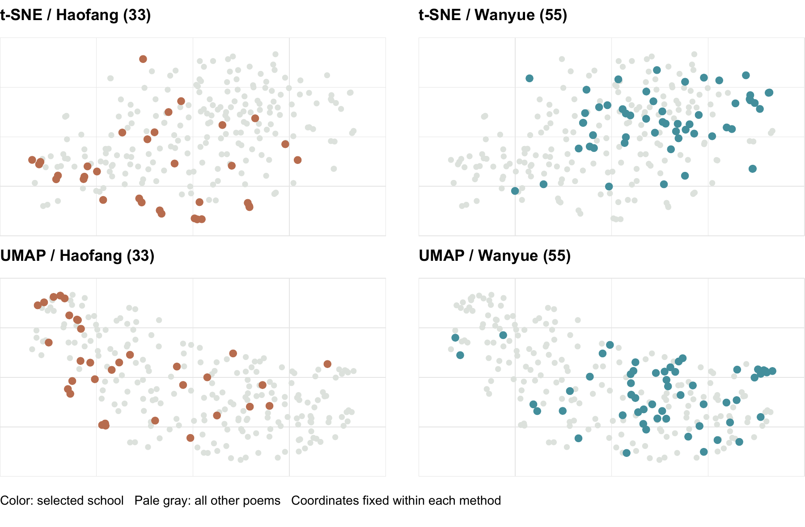
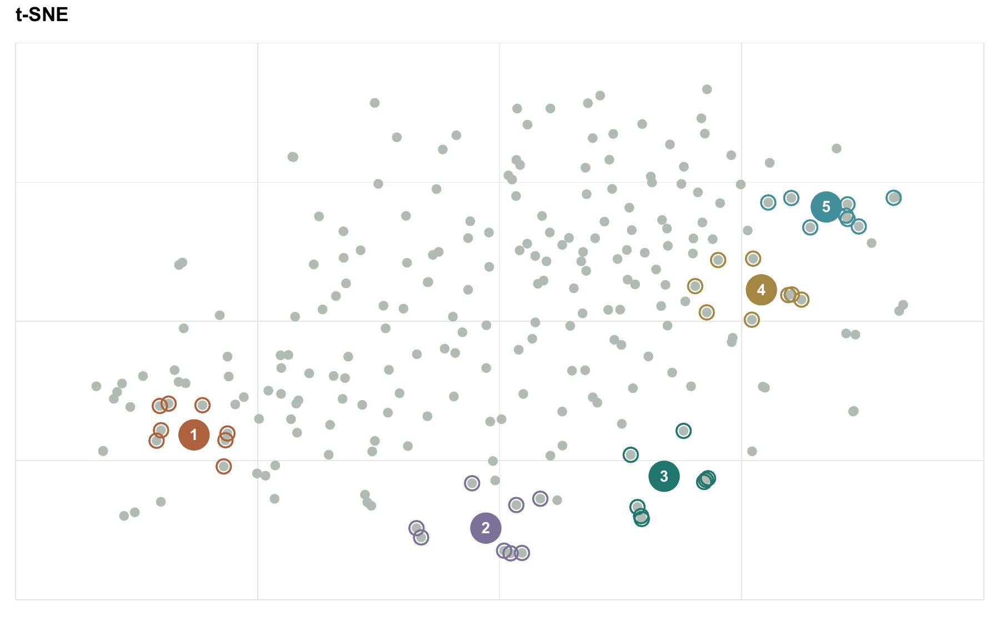

# The shape of Song Ci

[English](FINDINGS.md) · [中文](FINDINGS.zh.md)

Can semantic maps reveal how Song Ci poems relate through style, imagery and emotion? This analysis combines fixed visualizations, original-vector comparisons and close reading.

Song Ci is a traditional Chinese lyric-poetry form, originally written to tune patterns. Its two major stylistic traditions are Haofang (豪放派), associated with expansive, heroic expression, and Wanyue (婉约派), associated with intimate, delicate expression. These are tendencies rather than rules for every poem.

Question: If each poem becomes a natural-language embedding in a vector database, will a nonlinear 2D map naturally separate the two schools? Will poems sharing imagery or emotion gather into nearby “islands”?

Audience: readers exploring Chinese poetry through semantic search. Data: 240 anthology entries and 96 canonical authors from Guwendao, captured October 20, 2026. Complete verse alone enters Qwen3-Embedding-4B: 2,560 dimensions, L2-normalized, stored in Supabase. Titles, poets and school labels are excluded from fitting.

School tendencies appear, but two separate camps do not. Only eight representative poets carry author-level labels; 152 poems remain unlabeled. In original vectors, the labeled poems have a silhouette of 0.094 (near zero indicates overlapping groups).

Incomplete separation may partly reflect school labels as scholarly summaries of a poet’s predominant style, rather than every work: Haofang representative 苏轼 also wrote the intimate, Wanyue-like elegy《江城子·乙卯正月二十日夜记梦》, mourning his wife.

Excluding same-author candidates, 61.4% of the five nearest labeled poems share the query’s school. Reassigning two of the eight authors to Haofang gives a 57.1% average; 8 of 28 assignments equal or exceed the observed value. This small author-level check does not establish a robust school boundary.

## Where themes gather

Big idea: the map suggests local themes more clearly than a clean division by poet school. The five proposed regions are reading hypotheses, with different levels of support.

Each numbered region uses the eight nearest t-SNE points to a manually chosen center. Positions are unchanged from the app; rings identify inspected poems, not fitted cluster boundaries. Original-vector cosine checks whether each apparent island is also close before projection.

| Region / location | Mean cosine | Other-author pairs only |
| --- | --- | --- |
| 1. Frontier & historical memory | 0.710 | 0.708 |
| 2. Life reflection | 0.621 | 0.592 |
| 3. Pastoral life | 0.651 | 0.648 |
| 4. Parting & remembrance | 0.671 | 0.672 |
| 5. Chamber longing | 0.728 | 0.707 |
| All 240 poems (pair average) | 0.624 | 0.623 |

Frontier/history and chamber longing are the strongest of these windows. Pastoral and parting windows also exceed the corpus pair average. Life reflection does not: its cross-author similarity is 0.592. The lower map area therefore needs a broader, less uniform interpretation.

## Read the islands

### 1. Frontier & historical memory | lower left

辛弃疾《永遇乐·京口北固亭怀古》：千古江山，英雄无觅，孙仲谋处。
张孝祥《水调歌头·和庞佑父》：湖海平生豪气，关塞如今风景，剪烛看吴钩。

Historical heroes, lost territory and martial imagery connect this five-author region. “Frontier/history” is more precise than assigning every poem to one school.

### 2. Life reflection | bottom

苏轼《定风波·莫听穿林打叶声》：一蓑烟雨任平生。
苏轼《江城子·乙卯正月二十日夜记梦》：十年生死两茫茫，不思量，自难忘。

Resilience and bereavement coexist nearby. Five of eight works are by 苏轼; the region is not a single emotion or a strong cross-author semantic island.

### 3. Pastoral life | lower right

辛弃疾《西江月·夜行黄沙道中》：稻花香里说丰年，听取蛙声一片。
秦观《行香子·树绕村庄》：树绕村庄，水满陂塘。

Fields, villages, crops and rural sounds recur across seven authors. A Haofang poet and a Wanyue poet meet through shared imagery.

### 4. Parting & remembrance | right

柳永《雨霖铃·寒蝉凄切》：执手相看泪眼，竟无语凝噎。
欧阳修《浪淘沙·把酒祝东风》：聚散苦匆匆，此恨无穷。

Farewell, absent companions and returning seasons link these works. Remembered loss also appears in 晏殊’s nearby poem about falling flowers.

### 5. Chamber longing | upper right

李清照《一剪梅·红藕香残玉簟秋》：一种相思，两处闲愁。
唐琬《钗头凤·世情薄》：欲笺心事，独语斜阑。

Intimate absence and enclosed spaces recur. Six of eight works are by 李清照; cross-author similarity remains high, but shared imagery is not identical emotion.

Conclusion: selected thematic islands are useful for discovery; automatic separation into two schools is not established. The app’s original-space nearest poems support close reading. Region selection is post hoc, and map proximity can distort distance. Next, have independent readers label themes without seeing the map and test another anthology.

Source anthology: Guwendao, 宋词三百首. School background: Li, Li & Guan, Art Appreciation (2nd ed.), Tsinghua University Press, 2018, p. 37.

[GitHub](https://github.com/yihan2588/the-shape-of-song-ci) · [Live app](https://song-ci-atlas.vercel.app)

Reproduce: `python analysis/semantic_findings.py`, then `python analysis/render_findings.py --lang en` and `--lang zh`. Saved coordinates and vectors are reused; the app is unchanged.
