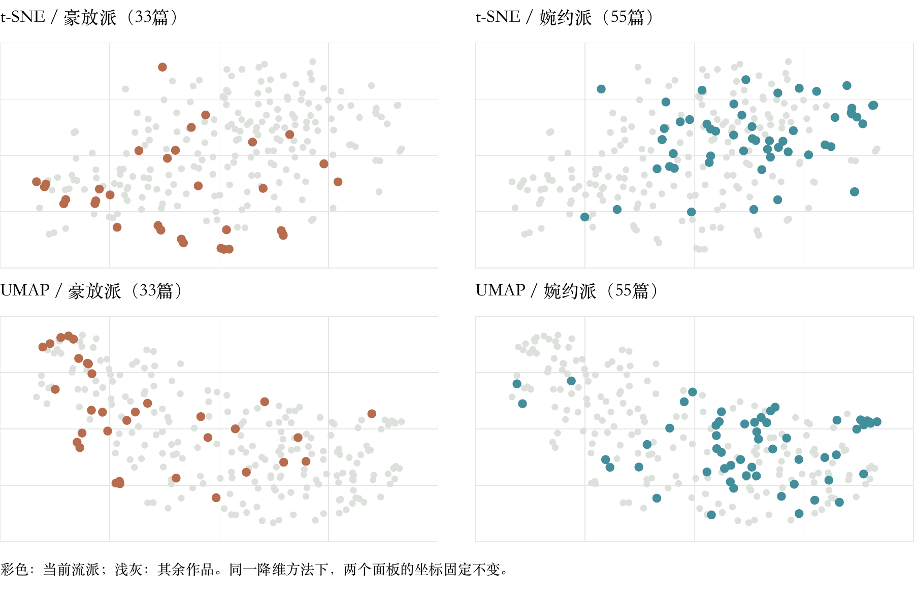

# 词之形：流派与主题的语义地图

[English](FINDINGS.md) · [中文](FINDINGS.zh.md)

语义地图能否呈现宋词在风格、意象与情感上的联系？本分析结合固定的二维可视化、原始向量比较与文本细读，探索这一问题。

词是中国传统抒情文学体裁，最初依词调填作。宋词的两大风格传统是豪放与婉约：豪放以开阔、雄健的表达见长，婉约以细腻、含蓄的情感见长。

研究问题：将每首词的自然语言嵌入存入向量数据库，再用非线性降维绘制二维地图，两大流派的作品会自然分开吗？意象或情感相近的作品，会聚成彼此邻近的“岛屿”吗？

面向读者：希望借助语义检索探索古典诗词的人。数据：2026年10月20日采集自古文岛的240篇选集条目，按统一署名规则归于96位作者。仅完整词作正文输入Qwen3-Embedding-4B，生成2,560维嵌入，经L2归一化后存入Supabase；标题、作者及流派标签均不参与拟合。

地图呈现出相互交叠的流派倾向。8位代表词人提供了33篇豪放派和55篇婉约派作品，另有152篇未标注。原始向量的轮廓系数为0.094，表明两组有较多交叠。

流派标签概括词人的主导风格，个人创作也常跨越不同风格：豪放派代表苏轼就写过婉约深挚的悼亡词《江城子·乙卯正月二十日夜记梦》，追念亡妻。

每篇词最相近的5篇其他作者的已标注作品中，有61.4%与其流派相同。将8位作者中任意2位重分为豪放派，28种分配的平均比例为57.1%，其中8种达到或超过观察值。

## 主题在哪里相聚

核心发现：地图将相近的意象与情感聚到一起。在本次查看的5个区域中，边塞与怀古、闺情与相思的相似度最高。

每个区域取距人工选定中心最近的8个t-SNE点，圆环标出这些作品。下表比较它们的原始向量余弦相似度，并单独列出不同作者作品配对的均值。

| 区域 | 余弦相似度均值 | 仅不同作者 作品配对 |
| --- | --- | --- |
| 1. 边塞与怀古 | 0.710 | 0.708 |
| 2. 抒怀 | 0.621 | 0.592 |
| 3. 田园 | 0.651 | 0.648 |
| 4. 别离与追忆 | 0.671 | 0.672 |
| 5. 闺情与相思 | 0.728 | 0.707 |
| 全部240篇（两两配对均值） | 0.624 | 0.623 |

边塞与怀古、闺情与相思、田园、别离的相似度均高于全体作品的两两配对均值。抒怀区域的跨作者相似度为0.592，低于0.623的基准，包含的情感也更为多样。

## 走进这些主题区域

### 1. 边塞与怀古｜左下

辛弃疾《永遇乐·京口北固亭怀古》：千古江山，英雄无觅，孙仲谋处。
张孝祥《水调歌头·和庞佑父》：湖海平生豪气，关塞如今风景，剪烛看吴钩。

历史英雄、失地之痛与征战意象，将5位作者的作品联系起来。

### 2. 抒怀｜下方

苏轼《定风波·莫听穿林打叶声》：一蓑烟雨任平生。
苏轼《江城子·乙卯正月二十日夜记梦》：十年生死两茫茫，不思量，自难忘。

旷达自持与悼亡之痛在此相邻。8篇中有5篇出自苏轼，他的创作在这一区域连接起多种情感。

### 3. 田园｜右下

辛弃疾《西江月·夜行黄沙道中》：稻花香里说丰年，听取蛙声一片。
秦观《行香子·树绕村庄》：树绕村庄，水满陂塘。

田野、村落、农作与乡间声息，在7位作者的作品中反复出现。豪放派与婉约派词人，因共同的田园意象在此相遇。

### 4. 别离与追忆｜右侧

柳永《雨霖铃·寒蝉凄切》：执手相看泪眼，竟无语凝噎。
欧阳修《浪淘沙·把酒祝东风》：聚散苦匆匆，此恨无穷。

离别、故人不在与节序更替，将这些作品联系起来；邻近的晏殊落花词中，也有追忆与失落之感。

### 5. 闺情与相思｜右上

李清照《一剪梅·红藕香残玉簟秋》：一种相思，两处闲愁。
唐琬《钗头凤·世情薄》：欲笺心事，独语斜阑。

亲密关系中的相思与室内空间反复出现。8篇中有6篇出自李清照，另有唐琬与陆游的作品；跨作者相似度为0.707。

结论：地图呈现出交叠的流派分布与可辨识的主题区域。读者可借助原始向量近邻，通过细读探索作品之间的联系。下一步可用独立的主题标注和另一部选集，检验本次选定的区域。

文本来源：古文岛《宋词三百首》。流派背景：李伟权、李时、关莹《艺术鉴赏》第2版，清华大学出版社，2018年，第37页。

[GitHub](https://github.com/yihan2588/the-shape-of-song-ci) · [Live app](https://song-ci-atlas.vercel.app)

复现：先运行 `python analysis/semantic_findings.py`，再分别运行 `python analysis/render_findings.py --lang en` 和 `--lang zh`。分析复用已保存的向量与坐标，不改变应用。
